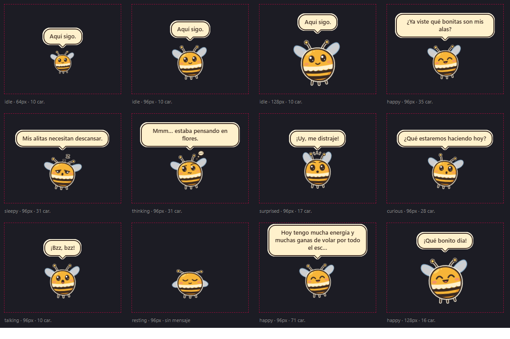
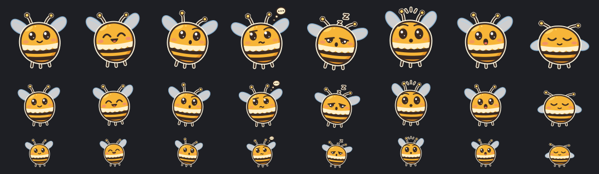

# Miel Desktop

**[Español](#español) · [English](#english)**

> **Estado / Status:** v0.1.0, **pre-release** (primera versión pública). Instalador **sin firmar** (SmartScreen avisará). Varias pruebas manuales siguen pendientes: ver [Limitaciones conocidas](#limitaciones-conocidas) y [`docs/TEST_LOG.md`](docs/TEST_LOG.md).
> **Pre-release** (first public release). **Unsigned** installer (SmartScreen will warn). Several manual tests are still pending: see [Known limitations](#known-limitations) and [`docs/TEST_LOG.md`](docs/TEST_LOG.md).



---

# Español

**Miel** es una pequeña abeja animada que vive en el escritorio de Windows 11: flota, a veces sigue al cursor, descansa, cambia de expresión y de vez en cuando dice una frase corta. Es discreta, ligera y **completamente local**: sin conexión, sin cuentas, sin claves, sin telemetría.

Está hecha con **Tauri 2 + Rust + React + TypeScript + Vite** (WebView2). No usa Electron ni servidores.

## Capturas

Estas imágenes se renderizaron con los componentes reales de la aplicación (compilación de desarrollo) sobre fondo liso, no son capturas de un escritorio.

| Reacción `happy` | Hoja de estados (fondo claro) | Hoja de estados (fondo oscuro) |
|---|---|---|
|  |  |  |

Las hojas de estados son una página de inspección del personaje, no la aplicación.

## Funcionalidades

- Ventana **transparente**, sin marco, siempre visible, **click-through** y sin robar el foco.
- Abeja original con **8 expresiones** (idle, happy, curious, thinking, sleepy, surprised, talking, resting).
- Comportamientos: **Idle**, **Follow** (seguimiento ocasional del cursor), **Rest** y **Reaction**.
- **Mensajes locales** en una burbuja integrada (catálogo de 16 frases; por defecto, como mínimo 12 minutos entre mensajes; el primero tarda entre 2 y 4 minutos tras arrancar y sale en un cambio de comportamiento).
- **Bandeja del sistema**: Mostrar, Ocultar, Seguir cursor, Pausar/Reanudar, Cerrar.
- **Preferencias persistentes** (JSON local) e **instancia única**.
- Soporte de varios monitores, coordenadas negativas, DPI y cambios de resolución (con comprobaciones manuales aún pendientes).

## Requisitos

**Para usarla:** Windows 11 **x64** con **WebView2** (viene con Windows 11; si faltara, el instalador usa el *bootstrapper* de Microsoft y **necesita conexión solo en ese caso**). No hay versión para otros sistemas ni para ARM64.

**Para desarrollar:** Node.js 22+, Rust estable (≥ 1.82) con el objetivo `x86_64-pc-windows-msvc`, Visual Studio Build Tools (MSVC) y Python 3 (solo para regenerar el personaje y la lista de licencias).

## Instalación

1. Descarga `Miel_0.1.0_x64-setup.exe` y `SHA256SUMS.txt` desde la página de [Releases](../../releases).
2. [Verifica el SHA-256](#verificar-el-sha-256) del instalador.
3. Ejecútalo. El instalador es **por usuario**: no pide privilegios de administrador. Se instala en `%LOCALAPPDATA%\Miel` y se desinstala desde *Configuración → Aplicaciones* o con el desinstalador.

Junto a `miel.exe` se instala `THIRD_PARTY_LICENSES.txt` (avisos y licencias de software de terceros), que se elimina al desinstalar.

El desinstalador ofrece la casilla *Eliminar los datos de la aplicación*: **si se marca, borra también las preferencias** (`%APPDATA%\lat.bkode.miel`) y los datos de WebView2 (`%LOCALAPPDATA%\lat.bkode.miel`).

> La instalación, actualización y desinstalación todavía **no las ha comprobado una persona de principio a fin** (pendiente en [`docs/TEST_LOG.md`](docs/TEST_LOG.md)).

### Advertencia de SmartScreen (instalador sin firmar)

El instalador **no tiene firma digital** todavía. Por eso Windows puede mostrar *"Windows protegió su PC"* (Microsoft Defender SmartScreen). Es esperable para un archivo sin firmar y con pocas descargas; **no** significa por sí solo que sea malicioso, pero tampoco lo descarta.

- Descarga el instalador **solo** desde la página de Releases de este repositorio y verifica el SHA-256.
- Si coincide y decides continuar: *Más información → Ejecutar de todas formas*.
- **No desactives SmartScreen ni el antivirus** para instalar Miel.
- Si prefieres no ejecutar un binario sin firmar, puedes [compilarla tú mismo](#desarrollo) desde el código.

### Verificar el SHA-256

En PowerShell, en la carpeta de la descarga:

```powershell
Get-FileHash .\Miel_0.1.0_x64-setup.exe -Algorithm SHA256
# o, con certutil:
certutil -hashfile .\Miel_0.1.0_x64-setup.exe SHA256
```

Compara el resultado, sin distinguir mayúsculas, con la línea correspondiente de `SHA256SUMS.txt` publicada en la misma release. **Si no coincide, no lo ejecutes** y abre un issue. Un hash publicado junto al archivo detecta descargas corruptas o alteradas en tránsito; no sustituye a una firma de código.

## Bandeja del sistema

El icono de Miel suele quedar en **"Mostrar iconos ocultos"** (Windows 11). Clic en él abre el menú:

| Opción | Efecto |
|---|---|
| **Mostrar Miel / Ocultar Miel** | Muestra u oculta la ventana (no cierra la app). Al mostrar se revalida la posición. |
| **Seguir cursor** (casilla) | Permite o impide que Miel siga al cursor. Se guarda. |
| **Pausar / Reanudar** | Congela movimiento, animaciones y mensajes. Se guarda. Ocultar y pausar son independientes. |
| **Cerrar Miel** | Cierra por completo (motor, subclase nativa, icono). |

Una segunda ejecución de Miel **no crea otra mascota**: solo pide a la primera que se muestre.

## Configuración

Archivo `settings.json` en el directorio de configuración de la app (por ejemplo `%APPDATA%\lat.bkode.miel\settings.json`). No hay ventana de configuración: se edita el JSON con Miel cerrada.

| Campo | Valores | Defecto |
|---|---|---|
| `follow_enabled` | `true`/`false` | `true` (la bandeja lo cambia y lo guarda) |
| `messages_enabled` | `true`/`false` | `true` |
| `message_interval_minutes` | 1–1440 | `12` |
| `pet_size` | `64`, `96` o `128` | `96` |
| `speed` | 60–600 (px/s) | `260` |
| `reduced_motion` | `true`/`false` | `false` (además se respeta el ajuste del sistema) |
| `paused` | `true`/`false` | `false` (la bandeja lo cambia y lo guarda) |

Valores fuera de rango se ajustan; campos con tipo erróneo vuelven a su valor por defecto; un archivo corrupto se **copia** a `settings.corrupt-<n>.json` (máx. 3) y Miel arranca con los valores por defecto. El estado *oculta* nunca se guarda: Miel siempre puede aparecer al iniciar.

## Privacidad

- Funciona **sin conexión**. La CSP solo permite recursos propios y el IPC local de Tauri; el código de Miel no tiene red, telemetría, cuentas ni claves.
- **No** lee archivos personales, **no** captura la pantalla, **no** registra teclado, **no** lee títulos ni lista ventanas activas.
- La posición del cursor se usa solo mientras Miel lo sigue, en memoria, para moverse; no se guarda.
- Solo escribe en su directorio de configuración (`%APPDATA%\lat.bkode.miel\settings.json`), en el de registros (`frontend-errors.log`, ≤ 64 KB, con rutas de disco eliminadas) y en el perfil de WebView2 (`%LOCALAPPDATA%\lat.bkode.miel\EBWebView`).
- El instalador, si falta WebView2, descarga el *bootstrapper* de Microsoft; es la única conexión relacionada con Miel y ocurre solo al instalar.
- El runtime WebView2 es un componente de Microsoft y se rige por su configuración y la de Windows.

Los principios que cualquier cambio futuro debe respetar están en [`ROADMAP.md`](ROADMAP.md).

## Desarrollo

```powershell
npm install                 # dependencias de desarrollo (Vite, TypeScript, Vitest, CLI de Tauri)
npm run tauri dev           # ejecuta la app (Ctrl+C o "Cerrar Miel" en la bandeja para salir)
npx tsc --noEmit            # tipos
npm test                    # pruebas del frontend (Vitest)
npm run build               # tsc + vite build + check:dist
npm run check:dist          # comprueba el frontend compilado (CSS del rig como archivo propio)
npm run licenses:check      # THIRD_PARTY_LICENSES.txt al día con Cargo.lock y package-lock.json (CI obligatoria)
npm run licenses            # regenerarlo tras cambiar dependencias (ver docs/DEPENDENCY_UPDATES.md)
cargo test   --manifest-path src-tauri/Cargo.toml
cargo clippy --manifest-path src-tauri/Cargo.toml --all-targets
npm run tauri build         # compilación de producción + instalador NSIS
```

La CI ([`.github/workflows/ci.yml`](.github/workflows/ci.yml)) ejecuta lo mismo en Windows. En desarrollo (y con `--features diag`) existen variables de diagnóstico que **no existen en el instalador**: `MIEL_FAST=1` (tiempos acelerados), `MIEL_DIAG_SCRIPT` (guion de pausa/ocultar para medir), `MIEL_SIMULATE_TRAY_FAILURE=1`. Ver `tools/measure.ps1` y [`docs/PERFORMANCE.md`](docs/PERFORMANCE.md).

> Importante: la CSP de producción es más estricta que la de desarrollo (`tauri dev`), y jsdom/Vitest tampoco la aplican. Si tocas estilos o SVG, prueba también el binario de producción; `check:dist` es la red de seguridad automática. Detalle en [`docs/ARCHITECTURE.md`](docs/ARCHITECTURE.md).

## Documentación

| Documento | Contenido |
|---|---|
| [`ROADMAP.md`](ROADMAP.md) | Hoja de ruta, principios y etapas futuras |
| [`docs/ARCHITECTURE.md`](docs/ARCHITECTURE.md) | Arquitectura (Rust como fuente de verdad, React solo dibuja), CSP, ciclo de vida, identidad |
| [`docs/BEE_GUIDE.md`](docs/BEE_GUIDE.md) | Guía del personaje (generador `tools/build_bee.py`) |
| [`docs/TEST_LOG.md`](docs/TEST_LOG.md) | Qué se probó, cómo y qué sigue pendiente |
| [`docs/PERFORMANCE.md`](docs/PERFORMANCE.md) | Metodología de medición. **Cifras invalidadas**: no citar |
| [`docs/DEPENDENCY_UPDATES.md`](docs/DEPENDENCY_UPDATES.md) | Cómo actualizar dependencias y regenerar los avisos de licencias |
| [`docs/CLEAN_CLONE_VALIDATION.md`](docs/CLEAN_CLONE_VALIDATION.md) · [`docs/MANUAL_TEST_CHECKLIST.md`](docs/MANUAL_TEST_CHECKLIST.md) | Validación desde un clon limpio y checklist manual de la release |
| [`docs/LICENSING.md`](docs/LICENSING.md) | Licencias: propuesta y puntos por confirmar |
| [`docs/PRIVACY.md`](docs/PRIVACY.md) | Qué consulta Miel y qué no; controles preventivos de privacidad |
| [`docs/THIRD_PARTY.md`](docs/THIRD_PARTY.md) | Licencias de las dependencias (lista) |
| [`THIRD_PARTY_LICENSES.txt`](THIRD_PARTY_LICENSES.txt) | Textos completos de licencia y avisos de copyright de terceros; se instala con Miel y se adjunta a cada release |
| [`docs/PUBLISHING_CHECKLIST.md`](docs/PUBLISHING_CHECKLIST.md) | Checklist de publicación |
| [`CHANGELOG.md`](CHANGELOG.md) | Cambios por versión |

## Contribuir

Lee [`CONTRIBUTING.md`](CONTRIBUTING.md) y el [Código de conducta](CODE_OF_CONDUCT.md). Se agradecen especialmente correcciones, documentación, traducciones, frases y expresiones nuevas del personaje. Antes de una funcionalidad grande, abre un issue y revisa [`ROADMAP.md`](ROADMAP.md): las contribuciones que rompan sus principios de privacidad no se aceptan.

## Reportar errores

Abre un [issue](../../issues/new/choose) con la plantilla de error (versión de Miel y de Windows, pasos, monitores/DPI). **No pegues datos personales ni capturas con contenido privado.** Las **vulnerabilidades** no van en issues públicos: ver [`SECURITY.md`](SECURITY.md).

## Solución de problemas

| Síntoma | Qué hacer |
|---|---|
| No veo a Miel | Busca el icono en *Mostrar iconos ocultos* → **Mostrar Miel**. Comprueba que no esté **pausada** (se ve quieta). |
| No encuentro el icono | Abre *Configuración → Personalización → Barra de tareas → Otros iconos de la bandeja* y activa "Miel". |
| Se queda quieta | Puede estar en **Rest** (descansa 40–90 s) o **pausada** (menú → Reanudar). |
| No sale ninguna burbuja | Es normal: la primera tarda 2–4 min y espera un cambio de comportamiento; luego hay 12 min entre mensajes. Pausar u ocultar cancela el mensaje. |
| Abrí Miel dos veces y no pasa nada | Es lo esperado (instancia única). |
| Ventana vacía/transparente sin abeja | Falló el renderizado o WebView2. Usa **Cerrar Miel** y vuelve a abrirla; revisa `frontend-errors.log`. |
| El instalador falla sin WebView2 | Necesita conexión para descargar el *bootstrapper*; instala el runtime de WebView2 de Microsoft. |
| Preferencias "olvidadas" | Si el JSON estaba corrupto se restableció; la copia queda en `settings.corrupt-*.json`. |

## Limitaciones conocidas

- **Instalador sin firmar** → advertencia de SmartScreen. La firma de código no está resuelta (ver [`ROADMAP.md`](ROADMAP.md)).
- **Pruebas manuales pendientes** (no se dan por hechas): instalación, actualización y desinstalación; varios monitores y cambios reales de DPI/resolución; clic real y foco con el instalador instalado; uso prolongado de 8 h. Detalle en [`docs/TEST_LOG.md`](docs/TEST_LOG.md).
- **Sin cifras de rendimiento**: las mediciones de CPU/RAM de [`docs/PERFORMANCE.md`](docs/PERFORMANCE.md) están **invalidadas** (se tomaron con una build que perdía las animaciones CSS) y **no deben citarse**; hay que repetirlas con la build corregida. Este README no afirma ningún consumo concreto.
- Miel aparece **encima de todo**, incluidas apps a pantalla completa (no hay modo "no molestar" todavía; ver Hito A en [`ROADMAP.md`](ROADMAP.md)).
- El centro del sprite no puede acercarse al borde superior de la pantalla a menos de `80 + tamaño/2` px (la ventana completa, con su espacio para la burbuja, debe caber en el monitor).
- Sin ventana de configuración ni opciones de tamaño/velocidad en la bandeja (solo por JSON).
- Si WebView2 muere, la ventana queda vacía (la bandeja sigue funcionando).
- Solo Windows 11 x64.
- **Licencias**: ver [`docs/LICENSING.md`](docs/LICENSING.md). Quedan pendientes la búsqueda de anterioridades de la marca y una revisión jurídica.

## Licencia

Copyright © 2026 Samuel David Hernández Contreras (BKODE).

- **Código y herramientas:** [MIT](LICENSE-MIT) o [Apache-2.0](LICENSE-APACHE), a tu elección.
- **Arte, personaje, stickers y documentación original:** [CC BY 4.0](LICENSE-ASSETS); cita a "Miel" y a su autor e indica si hiciste cambios.
- **Nombre "Miel", BKODE, logotipo e iconos de la aplicación:** sin licenciar; ver la [política de marca](TRADEMARK_POLICY.md). No se afirma ningún registro de marca.
- **Terceros:** conservan sus licencias ([`THIRD_PARTY_LICENSES.txt`](THIRD_PARTY_LICENSES.txt), [`docs/THIRD_PARTY.md`](docs/THIRD_PARTY.md)).
- **Contribuciones:** con [DCO](DCO.md) (`Signed-off-by`), sin CLA. Detalles en [`docs/LICENSING.md`](docs/LICENSING.md) y [`NOTICE`](NOTICE).

---

# English

**Miel** is a small animated bee that lives on your Windows 11 desktop: it floats, occasionally follows the cursor, rests, changes expression, and now and then says a short line. It is discreet, lightweight and **fully local**: no network, no accounts, no keys, no telemetry.

Built with **Tauri 2 + Rust + React + TypeScript + Vite** (WebView2). No Electron, no servers.

## Screenshots

These images were rendered with the app's real components (development build) on a plain background; they are not desktop screenshots. See the table in the Spanish section: [`docs/img/expr-Reaction.png`](docs/img/expr-Reaction.png), [`docs/sheet-light.png`](docs/sheet-light.png), [`docs/sheet-dark.png`](docs/sheet-dark.png), [`docs/img/bubbles-dark.png`](docs/img/bubbles-dark.png).

## Features

- **Transparent**, frameless, always-on-top, **click-through** window that never steals focus.
- Original bee with **8 expressions** (idle, happy, curious, thinking, sleepy, surprised, talking, resting).
- Behaviors: **Idle**, **Follow** (occasionally follows the cursor), **Rest** and **Reaction**.
- **Local messages** in an in-window speech bubble (16-phrase catalog; at least 12 minutes apart by default; the first one appears 2–4 minutes after launch, on a behavior change).
- **System tray**: Show, Hide, Follow cursor, Pause/Resume, Quit.
- **Persistent preferences** (local JSON) and **single instance**.
- Multi-monitor, negative coordinates, DPI and resolution changes (real-world checks still pending).

## Requirements

**To run it:** Windows 11 **x64** with **WebView2** (ships with Windows 11; if missing, the installer uses Microsoft's bootstrapper and **needs a connection only in that case**). No other OS and no ARM64 build.

**To develop:** Node.js 22+, stable Rust (≥ 1.82) with the `x86_64-pc-windows-msvc` target, Visual Studio Build Tools (MSVC), and Python 3 (only to regenerate the character and the license list).

## Installation

1. Download `Miel_0.1.0_x64-setup.exe` and `SHA256SUMS.txt` from the [Releases](../../releases) page.
2. [Verify the SHA-256](#verify-the-sha-256) of the installer.
3. Run it. It is a **per-user** installer: no administrator rights. It installs to `%LOCALAPPDATA%\Miel` and uninstalls from *Settings → Apps* or via its uninstaller.

`THIRD_PARTY_LICENSES.txt` (third-party software notices and licenses) is installed next to `miel.exe` and removed on uninstall.

The uninstaller offers a *Delete application data* checkbox: **if checked, it also deletes preferences** (`%APPDATA%\lat.bkode.miel`) and WebView2 data (`%LOCALAPPDATA%\lat.bkode.miel`).

> Install, update and uninstall have **not yet been verified end to end by a person** (pending in [`docs/TEST_LOG.md`](docs/TEST_LOG.md)).

### SmartScreen warning (unsigned installer)

The installer is **not code-signed** yet, so Windows may show *"Windows protected your PC"* (Microsoft Defender SmartScreen). That is expected for an unsigned, little-downloaded file; it does not by itself mean the file is malicious, but it does not rule it out either.

- Download the installer **only** from this repository's Releases page and verify its SHA-256.
- If it matches and you decide to continue: *More info → Run anyway*.
- **Do not disable SmartScreen or your antivirus** to install Miel.
- If you would rather not run an unsigned binary, [build it yourself](#development) from source.

### Verify the SHA-256

In PowerShell, in the download folder:

```powershell
Get-FileHash .\Miel_0.1.0_x64-setup.exe -Algorithm SHA256
# or, with certutil:
certutil -hashfile .\Miel_0.1.0_x64-setup.exe SHA256
```

Compare the result, case-insensitively, with the matching line in `SHA256SUMS.txt` from the same release. **If it does not match, do not run it** and open an issue. A hash published next to the file detects corrupted or tampered downloads; it is not a substitute for code signing.

## Tray menu

Miel's icon usually sits under **"Show hidden icons"** (Windows 11). Click it to open the menu:

| Option | Effect |
|---|---|
| **Show Miel / Hide Miel** | Shows or hides the window (does not quit). Position is revalidated on show. |
| **Follow cursor** (checkbox) | Allows or prevents Miel from following the cursor. Saved. |
| **Pause / Resume** | Freezes movement, animations and messages. Saved. Hide and pause are independent. |
| **Quit Miel** | Quits completely (engine, native subclass, icon). |

Running Miel a second time **does not create another pet**: it only asks the first one to show itself. (The tray menu labels are in Spanish in v0.1.0; there is no localization yet.)

## Settings

`settings.json` in the app config directory (e.g. `%APPDATA%\lat.bkode.miel\settings.json`). There is no settings window: edit the JSON while Miel is closed. Fields: `follow_enabled`, `messages_enabled`, `message_interval_minutes` (1–1440, default 12), `pet_size` (64, 96 or 128; default 96), `speed` (60–600 px/s, default 260), `reduced_motion`, `paused`. Out-of-range values are clamped, wrongly-typed fields reset to their default, and a corrupt file is **copied** to `settings.corrupt-<n>.json` (max. 3) before Miel starts with defaults. The *hidden* state is never saved. The full table is in the Spanish section.

## Privacy

- Works **offline**. The CSP only allows the app's own resources and Tauri's local IPC; Miel's code has no networking, telemetry, accounts or keys.
- It does **not** read personal files, **not** capture the screen, **not** log the keyboard, **not** read window titles or list active windows.
- The cursor position is used only while Miel follows it, in memory; it is never stored.
- It only writes to its config directory (`%APPDATA%\lat.bkode.miel\settings.json`), its log directory (`frontend-errors.log`, ≤ 64 KB, disk paths stripped) and the WebView2 profile (`%LOCALAPPDATA%\lat.bkode.miel\EBWebView`).
- If WebView2 is missing, the installer downloads Microsoft's bootstrapper; that is the only Miel-related connection and it happens only at install time.
- The WebView2 runtime is a Microsoft component governed by its own and Windows' settings.

The principles any future change must respect are in [`ROADMAP.md`](ROADMAP.md) (written in Spanish).

## Development

```powershell
npm install
npm run tauri dev
npx tsc --noEmit
npm test
npm run build               # tsc + vite build + check:dist
npm run check:dist
npm run licenses:check      # third-party notices up to date with the lockfiles (required CI check)
cargo test   --manifest-path src-tauri/Cargo.toml
cargo clippy --manifest-path src-tauri/Cargo.toml --all-targets
npm run tauri build         # production build + NSIS installer
```

CI ([`.github/workflows/ci.yml`](.github/workflows/ci.yml)) runs the same on Windows. Diagnostic environment variables (`MIEL_FAST`, `MIEL_DIAG_SCRIPT`, `MIEL_SIMULATE_TRAY_FAILURE`) exist only in development or with `--features diag`, **never in the installer**.

> Important: the production CSP is stricter than the dev one (`tauri dev`), and jsdom/Vitest do not apply it either. If you touch styles or SVG, also test the production binary; `check:dist` is the automatic safety net. Details in [`docs/ARCHITECTURE.md`](docs/ARCHITECTURE.md).

## Documentation

Most documents are in Spanish; translations are welcome. See the table in the Spanish section: [`ROADMAP.md`](ROADMAP.md), [`docs/ARCHITECTURE.md`](docs/ARCHITECTURE.md), [`docs/BEE_GUIDE.md`](docs/BEE_GUIDE.md), [`docs/TEST_LOG.md`](docs/TEST_LOG.md), [`docs/PERFORMANCE.md`](docs/PERFORMANCE.md), [`docs/LICENSING.md`](docs/LICENSING.md), [`docs/PRIVACY.md`](docs/PRIVACY.md), [`docs/THIRD_PARTY.md`](docs/THIRD_PARTY.md), [`THIRD_PARTY_LICENSES.txt`](THIRD_PARTY_LICENSES.txt), [`CHANGELOG.md`](CHANGELOG.md).

## Contributing

Read [`CONTRIBUTING.md`](CONTRIBUTING.md) and the [Code of Conduct](CODE_OF_CONDUCT.md). Fixes, documentation, translations, phrases and new character expressions are especially welcome. For a larger feature, open an issue first and check [`ROADMAP.md`](ROADMAP.md): contributions that break its privacy principles are not accepted.

## Reporting bugs

Open an [issue](../../issues/new/choose) with the bug template (Miel and Windows versions, steps, monitors/DPI). **Do not paste personal data or screenshots with private content.** **Vulnerabilities** do not go in public issues: see [`SECURITY.md`](SECURITY.md).

## Known limitations

- **Unsigned installer** → SmartScreen warning. Code signing is not solved yet (see [`ROADMAP.md`](ROADMAP.md)).
- **Pending manual tests** (not claimed as done): install, update and uninstall; multiple monitors and real DPI/resolution changes; real clicks and focus with the installed build; 8-hour soak. Details in [`docs/TEST_LOG.md`](docs/TEST_LOG.md).
- **No performance figures**: the CPU/RAM measurements in [`docs/PERFORMANCE.md`](docs/PERFORMANCE.md) are **invalidated** (taken with a build that lost its CSS animations) and **must not be quoted**; they must be redone with the fixed build. This README makes no claim about actual resource usage.
- Miel shows **on top of everything**, including full-screen apps (no "do not disturb" yet; see Milestone A in [`ROADMAP.md`](ROADMAP.md)).
- The sprite center cannot get closer to the top screen edge than `80 + size/2` px.
- No settings window and no size/speed options in the tray (JSON only).
- If WebView2 dies, the window stays empty (the tray keeps working).
- Windows 11 x64 only. Interface text and phrases are in Spanish only.
- **Licenses**: see [`docs/LICENSING.md`](docs/LICENSING.md). A trademark prior-art search and a legal review are still pending.

## License

Copyright © 2026 Samuel David Hernández Contreras (BKODE).

- **Code and tooling:** [MIT](LICENSE-MIT) or [Apache-2.0](LICENSE-APACHE), at your option.
- **Art, character, stickers and original documentation:** [CC BY 4.0](LICENSE-ASSETS); credit "Miel" and its author and indicate changes.
- **The name "Miel", BKODE, the logo and the application icons:** not licensed; see the [trademark policy](TRADEMARK_POLICY.md). No trademark registration is claimed.
- **Third parties:** keep their own licenses ([`THIRD_PARTY_LICENSES.txt`](THIRD_PARTY_LICENSES.txt), [`docs/THIRD_PARTY.md`](docs/THIRD_PARTY.md)).
- **Contributions:** under the [DCO](DCO.md) (`Signed-off-by`), no CLA. Details in [`docs/LICENSING.md`](docs/LICENSING.md) and [`NOTICE`](NOTICE).
